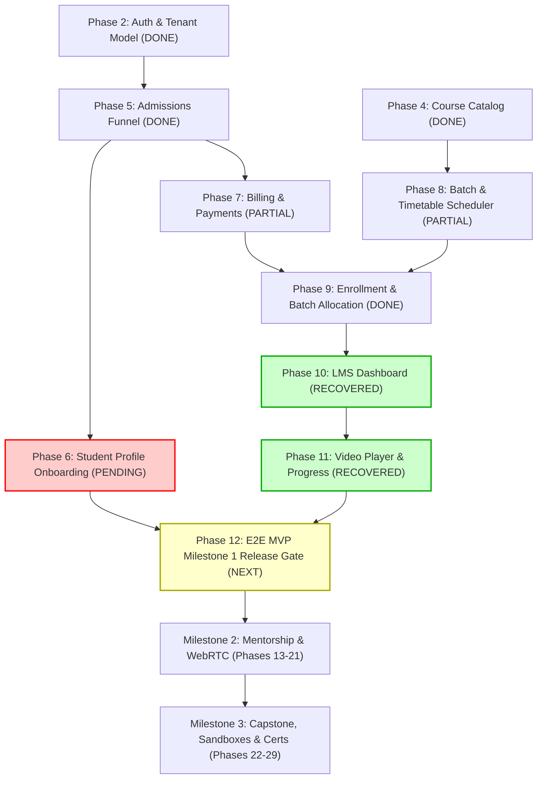

# NEXARATS ACADEMY — ROADMAP PHASE ALIGNMENT & RECONCILIATION

**Document ID:** `PHASE_ALIGNMENT`  
**Classification:** Enterprise Architecture & Roadmap Governance  
**Project:** Nexarats Academy  
**Master Roadmap Reference:** `docs/academy-roadmap/11_COMPLETE_70_PHASE_ROADMAP.md` (Phases 0–69)  
**Baseline Audited Commit:** `268e666`  
**Recovery Baseline:** Phase 6 Recovery  
**Status:** ACTIVE RECONCILIATION  

---

## 1. Executive Summary & Purpose

During the independent architecture, security, and QA audit of Phase 6, a significant roadmap misalignment was identified between the **Master 70-Phase Implementation Roadmap** (`11_COMPLETE_70_PHASE_ROADMAP.md`) and the **Implementation Reports** (Reports 36–43).

Specifically:
- In the Git repository and implementation reports, "Phase 6" implemented the **Student LMS Dashboard** and the **Modular Curriculum Video Player with Progress Tracking**.
- In the master enterprise architecture blueprint, **Phase 6** was defined as **Student Profile & Academic Onboarding** (`student_profiles`, `legal_agreements`, avatar S3 upload, ClamAV anti-malware scanning, terms e-signing), while the LMS Dashboard and Video Player were specified as **Phase 10** and **Phase 11**.
- In addition, parts of Roadmap Phase 7 (*Tuition Billing & Installments*), Phase 8 (*Cohort Batch Scheduler & Timetable Engine*), and Phase 9 (*Student Enrollment & Batch Allocation*) were partially collapsed into Git Phase 5 (`enrollments` and `payments` tables) without delivering the full timetable conflict detection engine or multi-step onboarding wizard.
- Implementation Report 43 prematurely proposed jumping directly to Phase 7 as "Capstone Assignment Submission, Code Execution Sandbox & Certificate Generation" (which corresponds to Milestone 3 / Roadmap Phases 22–29).

This document establishes the official bidirectional mapping, documents missing deliverables, enforces architectural prerequisites, and preserves the complete 70-phase master roadmap without rewriting historical commits.

---

## 2. Bidirectional Phase Mapping Matrix

The table below reconciles Git implementation phases with the master 70-phase specification:

| Git / Report Phase | Implemented Domain | Master Roadmap Phase | Master Roadmap Title | Delivery Milestone | Reconciliation Status |
|:---|:---|:---|:---|:---|:---|
| **Phase 0** | Baseline Preservation & Gap Analysis | **Phase 0** | Existing Project Audit & Expansion Blueprint | Milestone 1 | **Verified Complete** |
| **Phase 1** | Monorepo Structure & Tooling | **Phase 1** | Enterprise Repository Monorepo Scaffold | Milestone 1 | **Verified Complete** |
| **Phase 2** | Auth, JWT, Roles, Tenants | **Phase 2** | Core Identity, Multi-Tenant Architecture & Auth | Milestone 1 | **Verified Complete** |
| **Phase 3** | Public Catalog & Dynamic Programs | **Phase 3** | Public Catalog & Dynamic Programs API | Milestone 1 | **Verified Complete** |
| **Phase 4** | Modular Course Catalog & Syllabus | **Phase 4** | Modular Course Catalog & Syllabus Engine | Milestone 1 | **Verified Complete** |
| **Phase 5** | Admissions Leads & Basic Checkout | **Phase 5** | Admissions Funnel & CRM Lead Pipeline | Milestone 1 | **Implemented (Partial Scope)** |
| *Merged into P5* | Payment Gateway & Transaction Logs | **Phase 7** | Tuition Billing, Installments & Payment Gateway | Milestone 1 | **Implemented (Basic Checkout only; Installments pending)** |
| *Merged into P5* | Basic Cohort Model | **Phase 8** | Cohort Batch Scheduler & Timetable Engine | Milestone 1 | **Partial (Timetable & Conflict Engine pending)** |
| *Merged into P5* | Student Course Enrollment State | **Phase 9** | Student Enrollment & Batch Allocation | Milestone 1 | **Implemented (Direct & Program enrollment)** |
| **Skipped** | *None in Git* | **Phase 6** | **Student Profile & Academic Onboarding** | Milestone 1 | **PENDING ROADMAP DELIVERABLE** |
| **Git Phase 6** | Student Learning Dashboard | **Phase 10** | Student LMS Dashboard (Core Portal Shell) | Milestone 1 | **Recovered & Verified** |
| **Git Phase 6** | Video Streaming & Watch Progress | **Phase 11** | Modular Curriculum Video Player & Progress | Milestone 1 | **Recovered & Verified** |
| **Next Target** | Formal Milestone 1 Acceptance | **Phase 12** | End-to-End MVP Milestone Release Gate | Milestone 1 | **Pending** |
| *Proposed in R43* | Capstone Sandbox & Certificates | **Phase 22–29**| Coding Sandboxes, Proctored Exams & Credentials | Milestone 3 | **DEFERRED (Prerequisites Required)** |

---

## 3. Inventory of Missing Roadmap Deliverables

The following architectural deliverables from Milestone 1 (Phases 0–12) remain pending implementation before any Milestone 2 (Mentorship/WebRTC) or Milestone 3 (Coding Sandbox/Certificates) work can commence:

### Deliverable A: Student Profile & Academic Onboarding (Original Phase 6)
- **Status:** Skipped in Git; required for student lifecycle completion.
- **Frontend Requirements:**
  - Multi-step onboarding wizard at `/portal/student/onboarding`.
  - Profile setup form (bio, career goals, timezone, GitHub/LinkedIn profile URL validation).
  - Terms of Service & Code of Conduct digital agreement e-signing.
- **Backend Requirements:**
  - S3/MinIO pre-signed URL generator for avatar image uploads.
  - Profile management service (`StudentProfileService`).
  - Legal agreement acceptance audit trail service.
- **Database Requirements:**
  - Tables: `student_profiles`, `legal_agreements` (Flyway migration V11).
- **Security:**
  - MIME-type validation, file size limits, and ClamAV integration for avatar uploads.
  - Transition student status from `ENROLLED` to `ACTIVE_STUDENT` only after agreement acceptance.

### Deliverable B: Timetable Engine & Conflict Detection (Original Phase 8)
- **Status:** Basic `cohort_batches` table exists, but schedule planning and conflict detection were deferred.
- **Backend Requirements:**
  - Timetable scheduling engine validating lecture halls, mentor timeslots, and student availability.
  - Overlap and double-booking conflict detection algorithms.
- **Database Requirements:**
  - Table: `batch_schedules` with recurring weekly timeslot definitions.

### Deliverable C: Installment Billing & Invoicing (Original Phase 7 Enhancements)
- **Status:** Basic upfront tuition payment transaction logged, but scheduled recurring installments and PDF tax invoices are deferred.
- **Backend Requirements:**
  - Installment scheduler (`installment_schedules`).
  - Automated PDF receipt/invoice generator.

---

## 4. Prerequisite Dependency Graph Before Capstone Work

> [!CAUTION]
> **Architectural Guardrail:** Capstone assignment submission and automated code execution sandboxes belong to **Milestone 3 (Phases 22–29)**. Attempting to implement Capstone Sandboxes immediately following Phase 6 bypasses:
> 1. Student Academic Onboarding and Legal Agreements (Phase 6).
> 2. End-to-End MVP Milestone Release Gate (Phase 12).
> 3. Mentor assignment and review infrastructure (Phase 13).
> 4. Video transcoding infrastructure (Phase 14).
> 
> Proceeding without these foundations would leave certificates unbacked by legal identity and capstone submissions with no mentor grading workflows.

---

## 5. Official Phase Naming Convention Going Forward

To prevent future confusion between git branch labels and the 70-phase enterprise roadmap:
1. Every new phase must cite both its **Execution Phase Number** and its **Master Roadmap Phase ID** (e.g., `Phase 06 (Roadmap Phases 10-11)`).
2. The backlog must schedule **Phase 6B (Student Profile & Academic Onboarding)** before the Milestone 1 release gate.
3. No roadmap phase will be renumbered, deleted, or skipped without an explicit Architecture Decision Record (ADR).

