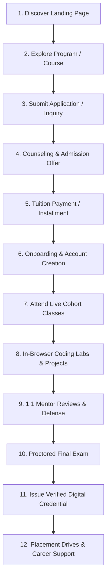

# NEXARATS ACADEMY — USER ROLES AND USER JOURNEYS
## Detailed Personas, End-to-End Workflow Lifecycles, and Authorization Boundaries

- **Document ID:** `04_USER_ROLES_AND_USER_JOURNEYS`
- **Execution Date:** 2026-10-13
- **Classification:** Enterprise Persona Specification & Lifecycle Journeys

---

## 1. Enterprise User Role Matrix & Authorization Hierarchy

| Role Code | Role Title | User Group | Access Scope | Primary Portal | Authorization Boundary |
| :--- | :--- | :--- | :--- | :--- | :--- |
| `ROLE_STUDENT` | B2C Learner | B2C Public | Enrolled courses, personal grades, live sessions, assigned mentor | Student LMS Portal | Read enrolled content; Submit assignments; Join assigned live sessions. |
| `ROLE_EMPLOYEE` | Corporate Learner | B2B Enterprise | Assigned corporate tracks, compliance modules, skill matrix | Employee L&D Portal | Scoped strictly to single Corporate Tenant; cannot view external B2C courses without license. |
| `ROLE_MENTOR` | Mentor / Instructor | Academic Staff | Assigned cohorts, scheduled live sessions, assignment grading | Mentor Portal | Scoped to assigned batches; can grade submissions and schedule 1:1 calls; cannot modify billing. |
| `ROLE_TA` | Teaching Assistant | Academic Staff | Cohort forum, lab queue, homework review queue | Mentor/TA Workbench | Can review code and answer forum tickets; cannot publish curriculum or final grades. |
| `ROLE_COUNSELOR` | Admissions Counselor | Operations Staff | Prospective leads, inquiry pipeline, counseling calendar | Admissions CRM | Scoped to assigned leads; can book counseling and issue offers; cannot view student LMS content. |
| `ROLE_EXAMINER` | Proctor / Examiner | Academic Staff | Question bank, exam schedules, proctoring telemetry | Examination Portal | Can create exams and review anti-cheat flags; cannot alter tuition or admission status. |
| `ROLE_FINANCE` | Finance Officer | Administrative | Invoices, payment gateways, installment schedules, refunds | Financial Operations | Read/write financial ledger, invoices, scholarships; cannot alter course grades. |
| `ROLE_ACADEMY_ADMIN` | Academy Administrator | Administrative | All academy programs, batches, mentors, students, certificates | Academy Admin Portal | Scoped to single Academy Tenant; full management of operational, academic, and student entities. |
| `ROLE_CORP_ADMIN` | Corporate HR / L&D Admin | B2B Enterprise | Corporate employees, departments, licenses, compliance reports | Corporate Admin Portal | Scoped to single Corporate Organization; manages employee seats and learning assignments. |
| `ROLE_GUARDIAN` | Parent / Sponsor | Consumer | Linked student's attendance, grades, installments, counselor chat | Guardian Portal | Read-only access to linked student metrics; write access to payment gateway for fees. |
| `ROLE_SUPER_ADMIN` | Platform Super Admin | Platform Owner | Global fleet of tenants, subscriptions, security policies, logs | Super Admin Portal | Unrestricted platform-wide governance across all tenants, databases, and microservices. |

---

## 2. End-to-End User Journey Specifications

### 2.1 The Student Journey (B2C Learner)


1. **Discovery & Exploration:**
   - Visits landing page (`/`), browses programs (`/programs`), filters courses (`/courses`), inspects mentor profiles (`/mentors`), reads success stories (`/success-stories`).
2. **Admissions & Evaluation:**
   - Opens `EnrollModal`, inputs background and contact info. Lead is assigned to counselor in CRM.
   - Attends virtual counseling session; takes online technical diagnostic test.
   - Receives official digital Admission Letter with cohort schedule and tuition breakdown.
3. **Enrollment & Payment:**
   - Selects payment option (Upfront, 3-Part Installment, or Income Share Agreement).
   - Pays fee through Stripe/Razorpay; receives signed enrollment agreement and invoice receipt.
4. **Onboarding & Active Learning:**
   - Receives email invitation to create account; logs in via `LoginModal` into the Student LMS Portal.
   - Joins Discord/Slack cohort community; syncs calendar for live weekend lectures.
   - Attends live WebRTC classes, participates in real-time polls, and accesses recorded sessions.
5. **Practical Mastery & Mentor Support:**
   - Completes weekly coding labs in Monaco IDE with automated unit test feedback.
   - Books weekly 1:1 video calls with assigned Big Tech mentor for architecture review and PR feedback.
6. **Examination & Certification:**
   - Completes proctored final capstone project defense; passes proctored comprehensive exam.
   - Automated issuance of tamper-proof credential with public verification link and LinkedIn badge.
7. **Career Acceleration & Placement:**
   - Enters Placement Crucible: resume reviewed by ATS optimizer; completes 5 Big Tech mock interviews.
   - Attends exclusive partner hiring drives; receives offers and undergoes salary negotiation counseling.

---

### 2.2 The Mentor & Instructor Journey
1. **Application & Verification:**
   - Submits mentor application with verified LinkedIn profile, current enterprise employer, and expertise domains.
   - Academy Admin conducts background review and technical interviewing interview.
   - Signs Mentor Services Agreement with approved hourly / cohort compensation terms.
2. **Cohort Assignment & Preparation:**
   - Assigned to specific cohort (e.g. "Full Stack Cohort 2026-A").
   - Reviews standardized curriculum, slide decks, and code starter repositories in Mentor Portal.
   - Sets weekly recurring 1:1 office hours availability slots.
3. **Teaching & Live Delivery:**
   - Launches live session from Mentor Portal with automated WebRTC SFU streaming and screen share.
   - Engages learners with real-time coding demonstrations and interactive polls.
   - Class automatically recorded and synced to student portal upon lecture termination.
4. **Evaluation & Feedback:**
   - Accesses Assignment Review Workbench: views student GitHub pull requests, leaves inline line comments, and assigns rubric scores.
   - Conducts 1:1 video calls for students who booked slots via the scheduling calendar.
   - Submits mid-cohort student risk flags for students requiring extra academic support.
5. **Payouts & Recognition:**
   - Reviews monthly automated timesheets and compensation calculations in Mentor Wallet.
   - Receives mentor satisfaction ratings and cohort completion bonuses.

---

### 2.3 The Academy Administrator Journey
1. **Program & Course Operations:**
   - Creates and updates programs, tracks, modules, lessons, and pricing tiers.
   - Manages academic calendar: starts new cohorts, defines holiday schedules, sets enrollment caps.
2. **Admissions Management:**
   - Monitors live admissions funnel dashboard: lead conversion rates, counselor performance, intake targets.
   - Approves scholarship applications and handles manual admission exception workflows.
3. **Mentor & Faculty Governance:**
   - Invites, verifies, and assigns instructors to cohorts; resolves timetable scheduling conflicts.
   - Reviews student feedback scores; monitors assignment grading turnaround times.
4. **Financial Oversight:**
   - Monitors tuition collections, overdue installment balances, and handles refund requests per policy.
   - Approves monthly faculty compensation disbursements.
5. **Quality & Placement Auditing:**
   - Reviews batch exam scores, capstone completion rates, and proctoring incident reports.
   - Tracks hiring partner placements, average salary packages, and placement guarantee compliance.

---

### 2.4 The Corporate Administrator Journey (B2B HR / L&D)
1. **Organization Setup:**
   - Signs enterprise contract; provisions corporate tenant with custom branding and domain.
   - Configures enterprise SSO (SAML 2.0 / Okta / Azure AD) and syncs company directory (SCIM).
2. **Department & Team Hierarchy:**
   - Creates departments (e.g., Engineering, Cloud Operations, Product, Data Science).
   - Assigns department managers with team-level reporting permissions.
3. **Curriculum Assignment:**
   - Selects pre-built technical tracks or customizes modular tracks to match corporate tech stacks.
   - Assigns mandatory compliance courses with firm deadlines and automated reminder cadence.
4. **Analytics & Compliance Monitoring:**
   - Views organization-wide dashboard: completion percentage, active learning hours, skill mastery heatmaps.
   - Downloads audit-ready compliance completion certificates for regulatory authorities.
5. **Seat & License Management:**
   - Monitors active seat utilization; reallocates licenses from departing employees to new hires.

---

### 2.5 The Corporate Employee Journey (B2B Learner)
1. **Access & Onboarding:**
   - Receives enterprise welcome email; logs in via single-click Enterprise SSO.
   - Completes 5-minute technical diagnostic questionnaire to baseline existing competencies.
2. **Structured Learning:**
   - Accesses assigned department curriculum; tracks mandatory compliance deadlines.
   - Watches modular bite-sized lessons, completes interactive coding exercises, and downloads job aids.
3. **Assessment & Skill Validation:**
   - Passes module competency assessments; completes practical work-related capstone simulations.
   - Earns internal corporate credentials and skill badges displayed on company profile.
4. **Continuous Development:**
   - Browses elective catalog to request advanced skill tracks; submits manager approval request with 1 click.

---

### 2.6 The Platform Super Administrator Journey (Platform Owner)
1. **Fleet & Tenant Provisioning:**
   - Creates new tenants (Academy branches, corporate enterprises, university partners).
   - Configures tenant database isolation strategy (schema-per-tenant vs pooled with RLS).
2. **Subscription & Billing Governance:**
   - Manages tenant SaaS subscription plans, user seat quotas, and storage tiers.
   - Monitors billing status, automated recurring invoicing, and payment failures.
3. **Platform Health & Telemetry:**
   - Monitors real-time global telemetry: API response latency, Redis cache hit rates, SFU video bandwidth, and database connection pools.
   - Inspects centralized audit logs for suspicious activities, brute-force attempts, or privilege escalations.
4. **System Maintenance & Updates:**
   - Coordinates blue/green zero-downtime updates; manages feature flag rollouts.

---

## 3. Authorization Boundaries & Missing Screens Map

### Missing Screen Requirements
To fulfill these journeys, the application must expand from the existing 8 public routes to support the following dedicated, role-protected screen suites:

```text
/portal/
├── student/                  # 30+ Protected Student Screens
│   ├── dashboard             # Overview, streaks, active courses
│   ├── courses/:id/player    # Full video + sandbox curriculum player
│   ├── assignments/:id       # Git sandbox submission & rubric review
│   ├── live-classrooms/:id   # WebRTC live room with chat & whiteboard
│   ├── mentorship/schedule   # 1:1 mentor booking & history
│   ├── credentials/:id       # Digital certificate & transcript
│   └── career-hub/jobs       # Placement drives, resume builder
│
├── mentor/                   # 20+ Protected Mentor Screens
│   ├── dashboard             # Teaching schedule, grading queue
│   ├── cohorts/:id/session   # Instructor studio & live room launcher
│   ├── grading/:submissionId # Side-by-side Git diff code review tool
│   ├── availability          # Weekly recurring slot picker
│   └── earnings              # Compensation ledger & payout history
│
├── admin/                    # 35+ Academy Admin Screens
│   ├── admissions/crm        # Kanban lead pipeline & counselor queue
│   ├── cohorts/manager       # Batch scheduler & teacher allocation
│   ├── curriculum/builder    # Drag-and-drop course & lesson editor
│   ├── finance/ledger        # Invoices, installments, refund requests
│   └── placement/analytics   # Company drives, student offer tracking
│
├── corporate/                # 25+ Corporate Admin Screens
│   ├── organization/tree     # Multi-department team management
│   ├── tracks/assign         # Bulk curriculum assignment engine
│   ├── compliance/audit      # Real-time compliance completion reports
│   └── licenses/seats        # SCIM sync & seat pool allocation
│
└── platform/                 # 25+ Super Admin Operations Screens
    ├── tenants/fleet         # Provisioning, domain mapping, quotas
    ├── system/telemetry      # SFU load, API latency, queue metrics
    ├── feature-flags         # Per-tenant progressive rollout toggles
    └── security/audit-logs   # Immutable security telemetry stream
```
