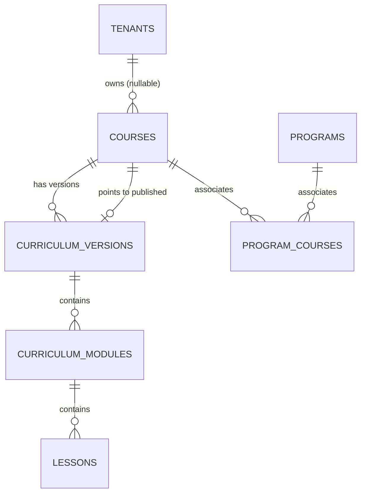

# 33. PHASE 4 DATABASE AND API REPORT
**Project:** Nexarats Academy Enterprise Education Platform  
**Roadmap:** 70 Phases (Phase 0–69)  
**Phase:** Phase 4 — Modular Course Catalog & Syllabus Engine  
**Date:** October 13, 2026  
**Status:** COMPLETE & VERIFIED  

---

## 1. Flyway V8 Schema Architecture
The migration is implemented in:
`services/core-backend/src/main/resources/db/migration/V8__create_courses_and_curriculum_schema.sql`

Existing migrations `V1` through `V7` were left untouched. `V8` applies forward-only schema definitions and idempotent seed data.

### 1.1 Tables Created

#### `courses` Table
- `id UUID PRIMARY KEY DEFAULT gen_random_uuid()`
- `tenant_id UUID REFERENCES tenants(id) ON DELETE SET NULL` (Nullable; NULL denotes platform-wide global courses)
- `slug VARCHAR(100) NOT NULL UNIQUE`
- `category VARCHAR(100) NOT NULL`
- `title VARCHAR(255) NOT NULL`
- `short_description VARCHAR(500) NOT NULL`
- `detailed_description TEXT`
- `image_asset_key VARCHAR(100) NOT NULL`
- `level VARCHAR(50) NOT NULL`
- `duration_weeks INTEGER NOT NULL CHECK (duration_weeks > 0)`
- `lessons_count INTEGER NOT NULL DEFAULT 0`
- `projects_count INTEGER NOT NULL DEFAULT 0`
- `rating NUMERIC(3, 2) NOT NULL CHECK (rating >= 1.0 AND rating <= 5.0)`
- `reviews_count INTEGER NOT NULL DEFAULT 0`
- `enrolled_students VARCHAR(50) NOT NULL DEFAULT '1,000+'`
- `instructor_name VARCHAR(100) NOT NULL`
- `instructor_company VARCHAR(100) NOT NULL`
- `badge VARCHAR(50)`
- `prerequisites TEXT`
- `tech_stack TEXT NOT NULL DEFAULT '[]'` (JSON array)
- `learning_outcomes TEXT NOT NULL DEFAULT '[]'` (JSON array)
- `status VARCHAR(30) NOT NULL DEFAULT 'PUBLISHED' CHECK (status IN ('DRAFT', 'PUBLISHED', 'ARCHIVED'))`
- `published_version_id UUID` (FK to active `curriculum_versions`)
- `is_featured BOOLEAN NOT NULL DEFAULT FALSE`
- `display_order INTEGER NOT NULL DEFAULT 0`
- `published_at TIMESTAMP WITH TIME ZONE DEFAULT CURRENT_TIMESTAMP`
- Timestamps: `created_at`, `updated_at`

#### `curriculum_versions` Table
- `id UUID PRIMARY KEY DEFAULT gen_random_uuid()`
- `course_id UUID NOT NULL REFERENCES courses(id) ON DELETE CASCADE`
- `version_number INTEGER NOT NULL`
- `version_label VARCHAR(50) NOT NULL DEFAULT 'v1.0.0'`
- `status VARCHAR(30) NOT NULL CHECK (status IN ('DRAFT', 'PUBLISHED', 'ARCHIVED'))`
- `changelog TEXT`
- `published_at TIMESTAMP WITH TIME ZONE`
- Timestamps: `created_at`, `updated_at`
- Constraint: `UNIQUE (course_id, version_number)`

#### `curriculum_modules` Table
- `id UUID PRIMARY KEY DEFAULT gen_random_uuid()`
- `version_id UUID NOT NULL REFERENCES curriculum_versions(id) ON DELETE CASCADE`
- `module_number VARCHAR(20) NOT NULL`
- `title VARCHAR(255) NOT NULL`
- `description TEXT`
- `duration VARCHAR(50) NOT NULL DEFAULT '2 Weeks'`
- `display_order INTEGER NOT NULL DEFAULT 0`
- `topics TEXT NOT NULL DEFAULT '[]'` (JSON array)
- Timestamps: `created_at`, `updated_at`
- Constraint: `UNIQUE (version_id, module_number)`

#### `lessons` Table
- `id UUID PRIMARY KEY DEFAULT gen_random_uuid()`
- `module_id UUID NOT NULL REFERENCES curriculum_modules(id) ON DELETE CASCADE`
- `title VARCHAR(255) NOT NULL`
- `summary TEXT`
- `lesson_type VARCHAR(50) NOT NULL CHECK (lesson_type IN ('VIDEO', 'READING', 'QUIZ', 'LAB', 'PROJECT', 'LECTURE'))`
- `display_order INTEGER NOT NULL DEFAULT 0`
- `duration_minutes INTEGER NOT NULL CHECK (duration_minutes > 0)`
- `is_previewable BOOLEAN NOT NULL DEFAULT FALSE`
- `preview_content TEXT`
- `status VARCHAR(30) NOT NULL DEFAULT 'PUBLISHED' CHECK (status IN ('DRAFT', 'PUBLISHED', 'ARCHIVED'))`
- Timestamps: `created_at`, `updated_at`
- Constraint: `UNIQUE (module_id, display_order)`

#### `program_courses` Table
- `program_id UUID NOT NULL REFERENCES programs(id) ON DELETE CASCADE`
- `course_id UUID NOT NULL REFERENCES courses(id) ON DELETE CASCADE`
- `display_order INTEGER NOT NULL DEFAULT 0`
- `created_at TIMESTAMP WITH TIME ZONE DEFAULT CURRENT_TIMESTAMP`
- Primary Key: `(program_id, course_id)`

---

## 2. Course-to-Program Relationships
Phase 3 created `programs` and `program_categories`. In Phase 4, the relationship between programs and courses is modeled as a normalized Many-to-Many mapping via `program_courses`. This provides:
1. Reusability: A foundational modular course (e.g., *Advanced React 19*) can belong to both a Full Stack program and a Frontend specialization.
2. Order preservation: Each program-course mapping retains a `display_order`.
3. Bidirectional API traversal: Course details return `relatedPrograms` (`id`, `slug`, `title`), allowing learners to explore comprehensive career pathways directly from course detail views.

---

## 3. Curriculum Versioning & Publication Workflow
Curricula evolve over time. Phase 4 implements an immutable versioning architecture:
1. **Draft Isolation:** New modules and lessons are attached to a draft `CurriculumVersion` (`status = 'DRAFT'`).
2. **Zero In-Place Mutation:** Live syllabuses serve only the version identified by `courses.published_version_id`.
3. **Atomic Publication:** Calling `CourseService.publishCurriculumVersion(courseId, versionId)`:
   - Validates that the version belongs to the course.
   - Sets the target version's status to `PUBLISHED` and updates `published_at`.
   - Atomically updates `courses.published_version_id` and `courses.status = 'PUBLISHED'`.
   - Triggers automated Redis eviction across all course catalog keys.
4. **Draft Leak Prevention:** If a course has no published version or is in `DRAFT` status, it is excluded from public catalog queries and syllabus endpoints.

---

## 4. REST API Endpoint Specification

All endpoints follow the canonical `/api/v1/academic/courses` path with backward-compatible aliases under `/api/v1/courses`.

| HTTP Method | Route | Public? | Description |
|---|---|---|---|
| `GET` | `/api/v1/academic/courses` | Yes | List published courses with category, level, search, and pagination filters. |
| `GET` | `/api/v1/academic/courses/{slug}` | Yes | Detailed course metadata, learning outcomes, instructor, and related programs. |
| `GET` | `/api/v1/academic/courses/{slug}/syllabus` | Yes | Published curriculum breakdown with ordered modules and lesson summaries. |
| `GET` | `/api/v1/academic/courses/{slug}/modules` | Yes | List ordered modules for the active published curriculum. |
| `GET` | `/api/v1/academic/courses/{slug}/lessons/{lessonId}/preview` | Yes | Access public lesson preview. Returns `200 OK` for previewable lessons; returns `403 Forbidden` RFC 7807 for locked lessons. |
| `POST` | `/api/v1/academic/courses/{courseId}/versions/{versionId}/publish` | Protected | Atomically publish a curriculum version. Requires administrative authority. |

---

## 5. Redis Caching Strategy
Dedicated cache namespace: `catalog:course:*`

| Cache Key Pattern | TTL | Invalidation Condition |
|---|---|---|
| `catalog:course:list:t={tenant}:cat={c}:lvl={l}:feat={f}:q={q}:p={p}:s={s}:sort={sort}` | 10 minutes | Course published, updated, or deleted |
| `catalog:course:detail:{slug}` | 15 minutes | Course updated or version published |
| `catalog:course:syllabus:{slug}` | 15 minutes | Curriculum version published |
| `catalog:course:preview:{slug}:{lessonId}` | 30 minutes | Lesson updated |

- **Resilience:** If Redis is unreachable, `CourseCatalogCacheService` catches exceptions and transparently falls back to PostgreSQL.
- **Isolation:** Phase 2 session keys (`auth:*`), Phase 3 program keys (`catalog:list:*`), and Phase 4 course keys (`catalog:course:*`) occupy distinct, isolated key spaces.

---

## 6. Multi-Tenant Scoping & Security Boundaries
1. **Platform vs Tenant Scoping:**
   - Platform-wide courses (`tenant_id IS NULL`) are visible across all public catalogs.
   - Tenant-specific courses (`tenant_id = {tenantId}`) are strictly scoped to the authorized tenant context and never leak into global or rival tenant catalogs.
2. **Server-Enforced Access Restrictions:**
   - Public users can view syllabus metadata and lessons marked with `is_previewable = true`.
   - Lessons marked `is_previewable = false` return `403 Forbidden` (`This lesson is locked. Enrollment is required to access private curriculum content.`).
   - Client applications never receive secret URLs or complete un-redacted lesson contents in syllabus metadata payloads.
